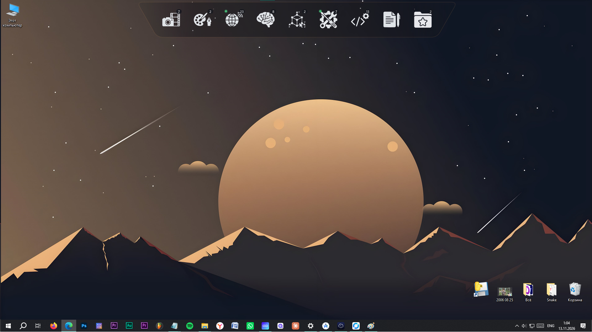
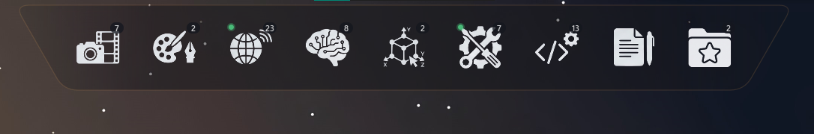
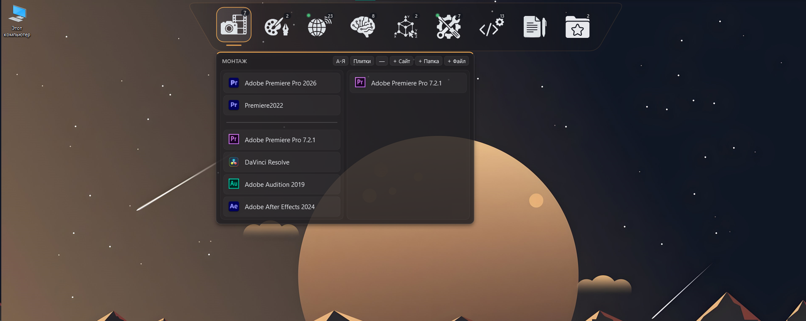
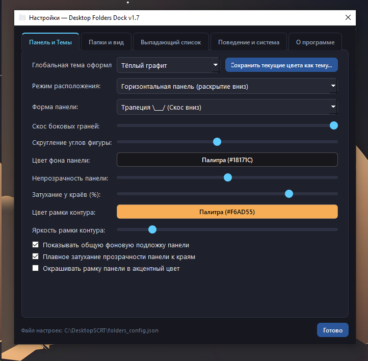
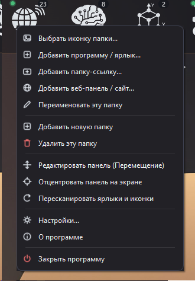

# Desktop Folders Dock

**Language:** [English](README.md) | [Русский](README.ru.md)

A lightweight, fast, and highly customizable desktop folder dock and quick application launcher for **Windows 10 / 11**. Organize your app shortcuts, directories, and local web panels into sleek thematic groups with instant access — even over fullscreen games.

---

##  Key Features

* **Flexible Dock Geometry & Styling:**
  * **Layout Modes:** Horizontal dock, vertical dock, or standalone free-floating folders on your desktop.
  * **Custom Shapes:** Rounded pill, trapezoid, hexagon, chamfered octagon, and rectangle with adjustable slant angles and corner radius.
  * **Visual Effects:** Smooth gradient edge-fade transparency, full color-picker customization, and built-in global themes (including Light and Dark modes) with the ability to save your own custom themes.
  * **Adaptive Menu Icons:** Crisp vector context menu icons that automatically adjust their contrast for light or dark backgrounds.
* **Smart Dropdown Lists:**
  * **3 View Modes:** Multi-column layout (fit everything at once), icon `Grid`, or a compact scrollable list.
  * **Organization:** Drag-and-drop item reordering, alphabetical sorting (`A–Z` / `А–Я`), custom section dividers, and moving shortcuts between folders.
  * **Live Status & Tooltips:** Green activity indicators for currently running processes and hover tooltips displaying full names for truncated labels.
* **Web Panels & Drag-and-Drop Support:**
  * Drag and drop any `.exe`, `.lnk`, folder, image (with a prompt to set it as the folder icon), or URL directly from your browser's address bar (`192.168.x.x`, local services, websites) with automatic `favicon` fetching.
* **In-Game Overlay Hotkey:**
  * Press a global hotkey (`Alt + Space` by default) to instantly summon the dock over fullscreen games or active windows. Once you launch an app or click outside the dock, "Always on Top" automatically turns off.
* **Intuitive Controls & Low-End PC Optimization:**
  * **Long-Press Reordering:** Hold Left Click (`0.42s`) on any folder to enter edit mode and rearrange folders with your mouse, or center the dock on screen in one click.
  * **Zero-Lag Startup:** Disk-based icon caching (`icon_cache`) and background indexing ensure instant startup without UI freezes, even on older hardware.
* **Localization & Backup:**
  * Full **English** and **Russian** interface support (switchable on the fly in Settings or during installation).
  * One-click export and import of all settings, themes, and folders into a single `.json` file.

---

##  Screenshots

---

## 🚀 Installation & Usage

### Option 1: Windows Installer (Recommended)
1. Go to the **[Releases](https://github.com/KeeroOne/DesktopFoldersDock/releases)** page.
2. Download the latest installer: **`DesktopFolders_Setup_v1.7.exe`**.
3. Run the setup wizard, choose your preferred language (**English** / **Русский**), installation directory, and shortcuts. No Python installation is required — all dependencies are bundled.

### Option 2: Run or Build from Source Code

### 💖 Support the Project
If you find this utility helpful, consider supporting its development:

CLOUDTIPS https://pay.cloudtips.ru/p/ac9cc579
DONATEPAY https://donatepay.ru/don/1542831